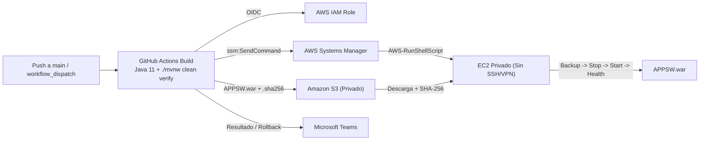

# Pipeline CI/CD — BackendVG (`APPSW.war`) en AWS EC2 vía SSM

## 1. Estructura de entregables

- `.github/workflows/deploy.yml` — Workflow de GitHub Actions (build Java 11 / Maven → S3 → SSM → Teams).
- `deploy/scripts/deploy.sh` — Script remoto idempotente en EC2 (respaldo, SHA-256, parada controlada por PID exacto, arranque, health check y rollback automático).
- `deploy/scripts/rollback.sh` — Script independiente de rollback manual o automático.
- `deploy/systemd/iniswtrp.service` — Unit file `systemd` opcional (si se decide migrar de `java -jar` directo a `systemd`).
- `deploy/aws/setup-aws-cicd.sh` — Script idempotente para provisionar S3 + OIDC + IAM Roles en AWS.
- `deploy/aws/iam-*.json` — Plantillas de políticas IAM de mínimo privilegio.

---

## 2. Arquitectura del despliegue



---

## 3. Configuración inicial en AWS (Cuenta `388260577258`, Región `us-east-1`)

> **Nota:** El usuario CLI local (`arn:aws:iam::388260577258:user/refrazul-cli`) no cuenta con permisos `iam:*`, `s3:*` ni `ssm:*` (`AccessDenied`). Un administrador de AWS debe ejecutar `deploy/aws/setup-aws-cicd.sh` (o aplicar los JSON de `deploy/aws/` en la consola IAM).

```bash
cd deploy/aws
chmod +x setup-aws-cicd.sh

AWS_REGION=us-east-1 \
AWS_ACCOUNT_ID=388260577258 \
S3_ARTIFACTS_BUCKET=vierge-backendvg-artifacts-388260577258 \
EC2_INSTANCE_ID=i-XXXXXXXXXXXXXXXXX \
EC2_INSTANCE_ROLE_NAME=<NombreDelRoleDelEC2> \
GITHUB_ORG=<tu-org-github> \
GITHUB_REPO=backendvg \
./setup-aws-cicd.sh
```

### Verificar en el EC2 (una sola vez)
1. `aws --version` instalado en el EC2.
2. `sudo systemctl status amazon-ssm-agent` → `active (running)` (ya verificado).
3. En AWS Console → Systems Manager → Fleet Manager: la instancia aparece **`Online`**.

---

## 4. GitHub Secrets y Variables

### Secrets (`Settings → Secrets and variables → Actions → Secrets`)
| Secret | Descripción |
|---|---|
| `AWS_ROLE_ARN` | ARN del IAM Role OIDC creado (`arn:aws:iam::388260577258:role/GitHubActions-BackendVG-EC2-Deploy`) |
| `TEAMS_WEBHOOK_URL` | Webhook de Microsoft Teams (reutilizar el mismo secreto/URL del proyecto ECS) |

### Variables (`Settings → Secrets and variables → Actions → Variables`)
| Variable | Ejemplo / Default | Descripción |
|---|---|---|
| `AWS_REGION` | `us-east-1` | Región de AWS |
| `EC2_INSTANCE_ID` | `i-0123456789abcdef0` | ID de la instancia EC2 destino |
| `S3_ARTIFACTS_BUCKET` | `vierge-backendvg-artifacts-388260577258` | Bucket S3 privado de artefactos |
| `APP_INSTALL_DIR` | `/home/ec2-user/app` | Directorio donde vive `APPSW.war` en el EC2 |
| `SPRING_PROFILE` | `sw-prod-tr` | Perfil Spring Boot activo |
| `USE_SYSTEMD` | `false` | `false` para `java -jar`, `true` si se administra con `systemd` |
| `APP_SERVICE_NAME` | `iniswtrp.service` | Nombre del servicio `systemd` (si `USE_SYSTEMD=true`) |
| `HEALTHCHECK_URL` | `http://127.0.0.1:80/` | Endpoint local de verificación post-arranque |

---

## 5. Procedimiento de pruebas sin afectar producción

1. Crear un ambiente `staging` en GitHub (`Settings → Environments`) apuntando a un `EC2_INSTANCE_ID` de pruebas/dev y `SPRING_PROFILE=sw-dev-tr`.
2. Ejecutar manualmente `Actions → CI/CD Build & Deploy BackendVG → Run workflow` seleccionando `environment = staging`.
3. Validar:
   - Compilación y pruebas unitarias en GitHub Actions.
   - Subida de `APPSW.war` + `.sha256` a S3.
   - Ejecución remota por SSM y `Health check OK`.
   - Prueba de rollback: lanzar un build con un `HEALTHCHECK_URL` inválido temporalmente y confirmar `ROLLBACK_STATUS=SUCCESS`.

---

## 6. Operación y Rollback manual

Si se requiere revertir manualmente en el EC2:
```bash
/home/ec2-user/app/scripts/rollback.sh
```
Los últimos 5 respaldos funcionales se conservan en `/home/ec2-user/app/backups/` y el enlace `last-good-APPSW.war` apunta siempre a la última versión válida.
